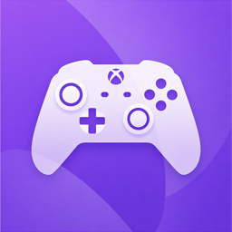

# Xplay

Turn your Mac into a zero-latency, zero-branding gaming screen for a console, using a €30 USB HDMI capture dongle.



## What it does

You have a Mac with a great screen — a Studio Display, an iMac, a MacBook Pro. You have a PS5, Xbox, Switch, or any HDMI source. You buy a cheap USB HDMI capture dongle (UGREEN and any MS2109/MS2130-based clone at around €30 on Amazon).

Xplay is a single-window macOS app that shows that dongle's output full-screen, at 1080p60, with no stutter, no menus, no watermark. Plug, launch, `Cmd+F`, play.

It's what you'd build if OBS Studio were stripped down to one job: display a UVC capture device cleanly on a Mac.

## Why not just use OBS?

OBS Studio works — it has a "Fullscreen Projector" feature that does roughly the same thing. But:

- OBS launches a full IDE-like window with scenes, sources, mixer, docks. Even if you never use them, they're there.
- Its preview uses a limited-range YUV conversion that slightly softens the image.
- It boots in a few seconds.

Xplay is 6 Swift files, launches instantly, renders with a BT.709 full-range GPU shader (sharper image), and the entire UI is "the video, full-screen". That's it.

## Features

- **1080p60 UVC capture**, locked to the dongle's exact native frame duration (handles the MS2109's 60.00024 Hz drift correctly).
- **Zero-copy YUV rendering** via Metal, BT.709 limited-range matrix in a fragment shader. Sharper than OBS's default preview.
- **OBS-style decoupled render loop**: a dedicated `CVDisplayLink` bound to the target display's vsync, with a PTS-indexed frame queue that picks the frame closest to the upcoming vsync. This is the trick that kills stutter on jittery UVC dongles.
- **Audio passthrough** from the dongle to your default output.
- **Auto-detection** of UGREEN / MS2109 / MS2130 / generic "capture" / "hdmi" devices, with a manual picker fallback.
- **Aspect-ratio-locked window** (16:9) — no black bars when resizing. Released in fullscreen.
- **Multi-display aware**: `Cmd+Shift+F` sends fullscreen to the other connected display, the display link rebinds to its vsync live.
- **No menubar clutter, no watermark, no branding**.

## Requirements

- macOS 13 or newer (Apple Silicon).
- Xcode 15+ to build from source.
- Any UVC-class USB HDMI capture dongle. Tested with a UGREEN unit (Actions Micro MS2109 chipset, VID `0x1de1` / PID `0xf105`).

## Build

```bash
git clone https://github.com/<your-user>/Xplay.git
cd Xplay
open Xplay.xcodeproj
# ▶ in Xcode, or Cmd+R
```

Or from the command line:

```bash
xcodebuild -project Xplay.xcodeproj -scheme Xplay -configuration Release build
cp -R ~/Library/Developer/Xcode/DerivedData/Xplay-*/Build/Products/Release/Xplay.app /Applications/
```

First launch triggers the macOS camera + microphone permission prompts. Accept both (camera permission is required to read from UVC devices; microphone is required for audio passthrough).

The app is ad-hoc signed. On first launch from `/Applications`, macOS Gatekeeper will refuse to open it:

> *"Xplay" can't be opened because it is from an unidentified developer.*

Workaround: right-click `Xplay.app` → **Open** → **Open**. macOS remembers your decision; subsequent launches work directly.

## Keyboard shortcuts

| Shortcut | Action |
|---|---|
| `Cmd+F` | Toggle fullscreen on current display |
| `Cmd+Shift+F` | Fullscreen on the other display (when 2 displays attached) |
| `Cmd+R` | Refresh the device list |
| `Cmd+Q` | Quit |

The **Source** menu shows all detected video capture devices and marks the active one.

## How it stays smooth

Three things together:

1. **Exact format & frame-duration lock**. The app enumerates the device's `AVCaptureDevice.Format`s, finds one at 1920×1080 supporting ≥59.94 fps, and sets `activeVideoMinFrameDuration = activeVideoMaxFrameDuration = range.minFrameDuration` using the device's own `CMTime` (never a hand-built `CMTime(1,60)`, which the MS2109 rejects because its internal clock is actually 60.00024 Hz).

2. **PTS-indexed frame queue**. The capture delegate pushes each `CVPixelBuffer` + host-clock PTS into a 4-slot queue. The queue never blocks the capture thread.

3. **CVDisplayLink-driven render**. A display link bound to the target `NSScreen`'s `CGDirectDisplayID` fires at exactly vsync. In its callback, the renderer asks the queue for the frame whose PTS is closest to (and not more than half a frame after) the upcoming vsync, and presents it. This decouples capture arrival from display timing, which is exactly how OBS Studio's async source queue (`get_closest_frame` in `libobs/obs-source.c`) handles the same problem — but we sync to vsync instead of a fixed timer, so a 4-slot queue is enough where OBS uses 30.

## Architecture

```
UVC dongle
  │  (capture thread, ~60 fps delivery, jittery)
  ▼
AVCaptureVideoDataOutput delegate
  │  extract CVPixelBuffer + PTS (host clock)
  ▼
FrameQueue.push()  — O(1), non-blocking, 4-slot ring
  │
  │  (independent)
  ▼
CVDisplayLink callback (display thread, target NSScreen vsync)
  │  FrameQueue.pickForHostTime(outputTime.hostTime)
  │  → closest frame with pts ≤ target + halfFrame, evict older
  ▼
CVMetalTextureCache → MTLTexture (zero-copy, YUV biplanar)
  ▼
CAMetalLayer (framebufferOnly, displaySyncEnabled)
  │  fragment shader: YUV→RGB (BT.709 limited) or BGRA passthrough
  ▼
present on drawable
```

Source files under [`Xplay/`](Xplay):

| File | Role |
|---|---|
| `XplayApp.swift` | `@main` App, window setup, command menus, fullscreen helper |
| `ContentView.swift` | Picker / permission / preview state switch |
| `CaptureController.swift` | AVCaptureSession, device discovery, format lock, audio passthrough |
| `FrameQueue.swift` | Thread-safe PTS-indexed 4-slot queue (`OSAllocatedUnfairLock`) |
| `PreviewView.swift` | `CAMetalLayer` + `CVDisplayLink` + embedded shader, display-link rebind on screen change |

## Stats & diagnostics

Launch the app, then watch Console.app filtered on `StreamView:` (the log prefix is historical). Every 30 seconds you get:

```
StreamView: stats pushed=1800 picked=1800 doubled=0 dropped=0
```

- `pushed` — frames the capture thread delivered.
- `picked` — frames the render thread actually displayed.
- `doubled` — same frame picked twice in a row (source fell behind display).
- `dropped` — frames evicted from the queue unused (source faster than display).

At matched rates (60 fps source on a 60 Hz display), both `doubled` and `dropped` should stay near zero.

## License

MIT. See [LICENSE](LICENSE).

## Credits

Developed by Chris Lefevre.

The architectural approach (PTS-indexed async frame queue + decoupled render clock) is directly inspired by OBS Studio's `libobs` design — specifically `get_closest_frame` in [`libobs/obs-source.c`](https://github.com/obsproject/obs-studio/blob/master/libobs/obs-source.c) — without linking or vendoring any of its code.
